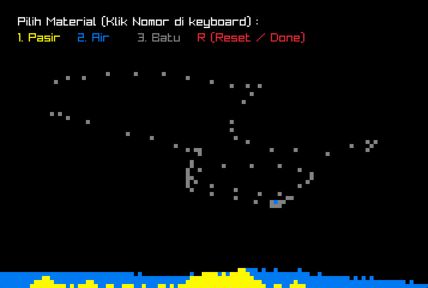

# 2D Voxel Simulation

<div align="center">

  <h3>Cellular Automata Simulation using C++ and Raylib</h3>

  <p>
    A simple 2D particle simulation where different materials interact
    through basic cellular automata rules.
  </p>

  <p>
    
    
    
    
  </p>

</div>

---

## Overview

**2D Voxel Simulation** is a small graphics programming project built with C++ and Raylib. It simulates different materials using a grid-based cellular automata approach.

Each particle follows simple movement rules depending on its material type, creating basic interactions between sand, water, and stone.

The project also includes a simple menu and interactive material placement.

## Preview

<div align="center">

  <!-- Replace with your actual GIF path -->

  

  <p><i> Priview Game(PNG) </i></p>

</div>

## Features

- **Sand Simulation:** Sand particles fall downward and diagonally when possible.
- **Water Simulation:** Water particles can move downward and horizontally.
- **Static Materials:** Stone particles remain stationary.
- **Interactive Placement:** Place materials using the mouse.
- **Material Selection:** Switch between materials using keyboard shortcuts.
- **Simple Menu:** Start the simulation through an interactive menu.
- **Grid-Based Simulation:** Uses a 108 × 72 two-dimensional array to represent the simulation world.

## Materials

| Material | Key | Color | Behavior |
|:---:|:---:|:---:|---|
| Sand | `1` | Yellow | Falls downward and diagonally |
| Water | `2` | Blue | Moves downward and horizontally |
| Stone | `3` | Gray | Remains stationary |

## Controls

| Input | Action |
|---|---|
| Left Mouse Button | Place the selected material |
| `1` | Select Sand / Pasir |
| `2` | Select Water / Air |
| `3` | Select Stone / Batu |
| `R` | End the current simulation |


## Technical Details

| Component | Implementation |
|---|---|
| Programming Language | C++ |
| Graphics Library | Raylib |
| Simulation Model | Cellular Automata |
| Grid Resolution | 108 × 72 |
| Window Resolution | 1080 × 720 |
| Target Frame Rate | 60 FPS |

### Simulation Logic

The simulation uses a two-dimensional integer array to store material states.

Each cell represents one of three materials or an empty space:

- `0` — Empty
- `1` — Sand
- `2` — Water
- `3` — Stone

During each update, the program checks particle positions and attempts to move them according to their respective movement rules.

## Requirements

- C++ Compiler
- Raylib
- C++ compatible development environment

## Getting Started

1. Clone this repository:

   ```bash
   git clone https://github.com/YOUR_USERNAME/YOUR_REPOSITORY.git
   ```

2. Navigate to the project directory:

   ```bash
   cd YOUR_REPOSITORY
   ```

3. Compile the source code with Raylib configured in your environment.

4. Run the compiled executable.

> **Note:** Build commands may vary depending on your operating system and Raylib installation.

## Project Structure

```text
2D-Voxel-Simulation/
├── asset/
│   └── Priview.png
├── src/
│   └── Voxel2DSimulation.cpp
├── .gitignore
├── LICENSE
└── README.md
```

## Future Improvements

- [ ] Improve particle movement and collision handling.
- [ ] Add more materials and particle interactions.
- [ ] Optimize simulation update performance.
- [ ] Add pause and reset functionality.
- [ ] Improve the user interface.
- [ ] Implement more advanced cellular automata rules.

## License

This project is licensed under the MIT License. See the [LICENSE](LICENSE) file for details.

---

<div align="center">
  <p>Built with C++ and Raylib.</p>
</div>